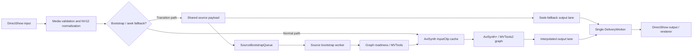

# DirectMotion

**A 64-bit DirectShow video frame-interpolation filter powered by AviSynth+ and MVTools2.**

- **Version:** `3.0.0`
- **Release status:** Windows x64 build and runtime validation completed.
- **Platform:** Windows x64
- **Output module:** `directmotion.ax`

DirectMotion receives decoded video samples through DirectShow, normalizes supported semi-planar YUV input, and builds an AviSynth+/MVTools2 graph to generate frames at a higher target frame rate. Its asynchronous pipeline separates source ingestion, frame processing, and downstream delivery. This separation coordinates seeking, pause/resume, buffering, and renderer backpressure across the filter's worker threads.

This README documents the implemented architecture, supported formats, build requirements, deployment model, and validation coverage. Compatibility depends on the specific DirectShow renderer, AviSynth+ runtime, and third-party plugin versions in use; not every combination is interchangeable.

---

## Contents

- [Highlights](#highlights)
- [Architecture overview](#architecture-overview)
- [Media formats and frame layout](#media-formats-and-frame-layout)
- [Threading and ownership model](#threading-and-ownership-model)
- [Source bootstrap and asynchronous output](#source-bootstrap-and-asynchronous-output)
- [Timing, generations, and seeking](#timing-generations-and-seeking)
- [Pause, resume, and stop](#pause-resume-and-stop)
- [AviSynth+ and MVTools2 integration](#avisynth-and-mvtools2-integration)
- [CPU and memory planning](#cpu-and-memory-planning)
- [Settings and compatibility](#settings-and-compatibility)
- [Runtime diagnostics](#runtime-diagnostics)
- [Build](#build)
- [Continuous integration](#continuous-integration)
- [Runtime deployment](#runtime-deployment)
- [Validation and tests](#validation-and-tests)
- [Troubleshooting](#troubleshooting)
- [Development guidelines](#development-guidelines)
- [Release artifacts](#release-artifacts)
- [License](#license)

## Highlights

- DirectShow **x64** transform filter.
- Accepts **NV12** and **NV21** input media types; NV21 is normalized to NV12 internally.
- Uses **AviSynth+** and **MVTools2** for motion-compensated frame interpolation.
- Supports fixed target-rate modes of **2×, 2.5×, 3×, and 4×**, plus **Auto** display-rate selection.
- Separates source ingestion, frame processing, and downstream delivery.
- Handles initial preroll, seek fallback, PTS watermarking, generation fencing, and a bounded visual handoff after seeking.
- Provides bounded queues, source-cache retention, backpressure handling, EOS draining, and runtime telemetry.
- Includes a portable C++17 policy/regression suite and a source-oriented CI validator.

## Architecture overview

The active video path is organized as follows:



The diagram shows the functional data path rather than every lock or synchronization edge. The main execution boundaries are:

1. **`Receive`** validates and normalizes upstream samples, then publishes source frames.
2. **`SourceBootstrapWorker`** stages and publishes frames while the graph is being prepared or a seek reset is being completed.
3. **`ProcessingWorker`** evaluates the AviSynth/MVTools graph and queues interpolated output.
4. **`DeliveryWorker`** is the sole downstream delivery consumer. It acquires allocator samples, copies or converts output, and calls downstream `Deliver`.

DirectMotion does not use a second MVTools-owned frame scheduler. AviSynth+ `Prefetch` provides graph-level parallel evaluation. The MVTools analysis calls explicitly use `mt=false` and, for `MAnalyse`, `temporal=false`; this avoids unintentionally nesting another scheduler.

## Media formats and frame layout

### Input and output contract

- The input major type is `MEDIATYPE_Video`.
- Supported semi-planar 8-bit subtypes are **NV12** and **NV21**.
- Both `FORMAT_VideoInfo` and `FORMAT_VideoInfo2` are recognized.
- The visible image must be at least 16×16 pixels and have even dimensions. Crop coordinates and physical surface dimensions must also satisfy the parser's alignment constraints.
- The negotiated output retains the input NV12/NV21 subtype. NV21 chroma pairs are swapped into NV12 order internally.
- The AviSynth source bridge uses planar **YV12** frames. Conversion takes place at the DirectShow/AviSynth boundary; output is converted back to the negotiated semi-planar layout before delivery to the renderer.

### Visible geometry and physical allocation geometry

DirectMotion keeps the visible image rectangle separate from the physical surface layout:

- Visible width and height describe the picture processed by the graph.
- Physical stride/pitch and surface height describe the memory layout.
- `rcSource` describes the upstream source selection.
- `rcTarget` describes where the visible image resides in the received physical buffer. An empty `rcTarget` means the full physical surface.

A padded surface must provide an explicit target rectangle when the visible image is smaller than the allocation. DirectMotion does not perform spatial scaling during media negotiation. The input parser uses the physical pitch and surface height when addressing the Y and UV planes; it must not derive the UV offset from visible width/height or from total sample length alone.

Output media types are offered using aligned, tightly packed surface candidates. The output allocator is checked for sufficient buffer count and payload size. Dynamic sample media types may update supported physical-layout details. A change to subtype, visible geometry, or an explicitly different frame cadence requires a new negotiation/graph consistent with the new media type.

`FORMAT_VideoInfo2` interlace metadata is tracked separately from pixel conversion. When the input is interlaced as two fields per sample, the filter propagates the relevant per-sample WEAVE indication. Parsing this metadata does not deinterlace the video.

## Threading and ownership model

The pipeline uses distinct execution roles:

| Component | Responsibility | Main operations |
|---|---|---|
| DirectShow `Receive` | Validate, normalize, and publish source samples | Input conversion, `PushSourceNv12`, staging/admission |
| `SourceBootstrapWorker` | Complete deferred graph bootstrap and publish staged source frames in order | Deferred reset completion, engine readiness, queue drain |
| `ProcessingWorker` | Determine when output can be evaluated and request graph frames | Bootstrap emission, `EmitNextAvailable`, `GetFrame` |
| `DeliveryWorker` | Serialize downstream allocator and renderer interaction | `GetDeliveryBuffer`, output copy/conversion, `Deliver` |
| Diagnostics/tray worker | Observe activity and refresh UI/telemetry | Snapshots, watchdog, tray messages |

AviSynth+ Prefetch may call `InputClip::GetFrame` concurrently. This does not transfer ownership of DirectShow delivery to Prefetch: `ProcessingWorker` requests output from the graph, while `DeliveryWorker` remains the only downstream consumer.

### Synchronization authorities

The filter does not rely on a single global lock. Its synchronization domains include:

- `m_csReceive`: DirectShow receive/segment state. This is a recursive `CCritSec` wrapping a Win32 `CRITICAL_SECTION`; a helper's local unlock does not release an outer ownership held by the input pin.
- `m_processingWorkerLifecycleMutex`: serializes `ProcessingWorker` start/stop/join and engine-reset quiescence.
- `m_processingWorkerMutex` + `m_processingWorkerChanged`: protect worker state and the actual `m_processingWorkerActive` quiescence predicate.
- `m_seekFallbackMutex`: owns compound seek-fallback state and its owner generation. Atomic published flags are mirrors/fast paths, not substitutes for the mutex-protected state.
- `m_deliveryPauseMutex` + condition variable: park and resume a packet during a stable pause.
- `m_deliveryMutex`: recursive delivery/generation fence. It does not replace the internal locks of `AsyncPipelineState`.
- `m_outputTimelineMutex`: protects concurrent output-timeline updates.

Encapsulated components (`AsyncPipelineState`, `SourceBootstrapQueue`, `AviSynthEvaluationGate`, and `AviSynthRuntimeSession`) own their synchronization domains. Their internal state must be accessed through their APIs rather than mirrored in filter-level flags or modified directly.

### Lifetime and quiescence

A stop flag or source-wait interrupt does **not** prove that a `ProcessingWorker` pass has finished. Before destroying an engine or graph, the caller must establish worker quiescence by waiting for `m_processingWorkerActive` to become false under the lifecycle protocol. If quiescence cannot be established, the engine is retained and the runtime failure path is used rather than risking use-after-free.

The filter owns a persistent `AviSynthRuntimeSession`; an `AviSynthMvToolsEngine` owns the graph for the current generation. Resetting the engine releases graph clips but does not tear down the filter's persistent AviSynth environment or unload the process-pinned runtime/plugin modules.

## Source bootstrap and asynchronous output

### SourceBootstrapQueue

`SourceBootstrapQueue` is a bounded, generation-aware FIFO between DirectShow ingestion and the AviSynth source cache. It is used during initial preroll and graph rebuilds, especially after seeking. During these transitions, `Receive` can return while the previous engine is quiesced or a replacement graph is prepared.

Key properties:

- Each staged frame carries a pipeline generation, a queue epoch, and a source-frame index.
- FIFO order preserves the order of admitted source samples.
- The default shared byte budget is **768 MiB**. Accounting uses the allocated vector capacity, not only the logical payload size.
- The same immutable NV12 payload may be shared with the seek-fallback delivery packet. Its memory charge is released only after the last shared reference is released.
- A frame removed by `WaitPop` remains outstanding until `CompleteFrame` is called. The production worker uses an RAII lease so cancellation and exception paths complete ownership correctly.
- A dormant initial-preroll queue can be rebound to the announced `NewSegment` generation only while all staged frames remain queued and no frame lease is in flight.
- The worker cannot consume a gated preroll queue until downstream/base `NewSegment` succeeds and the final generation is accepted.

The queue budget uses lazy accounting; it does not preallocate 768 MiB. The seek-fallback output lane has a separate **1024-packet** capacity. These limits protect different resources: one tracks shared payload memory, the other bounds fallback packets.

### AsyncPipelineState

`AsyncPipelineState` owns the bounded input/output queues and generation lifecycle. Output uses two lanes:

1. Interpolated frames produced by MVTools.
2. Source-frame fallback packets used during seek handoff.

A single `DeliveryWorker` consumes both lanes. The merge is PTS-based, with the source-fallback lane taking precedence in the defined equal-PTS tie. Each packet carries an immutable timing snapshot, so delivery does not reconstruct timestamps from mutable `Receive` state after a seek or segment change.

Queue cancellation or failure wakes blocked producers and consumers. Packets that carry completion state must be acknowledged even when discarded. EOS uses an ordered drain barrier so downstream EOS cannot overtake previously queued frames. Worker joins remain the responsibility of `CDirectMotion`; the pipeline coordinator destructor does not join threads.

`ProcessAvailableFrames` limits an ordinary pass to **128 successfully queued outputs**. A bounded continuation is re-armed only while the generation is current and the worker is not stopped, suspended, paused, transitioning, or failed. Continuation notifications coalesce with new source-publication notifications so a pending `Receive` signal is not lost.

## Timing, generations, and seeking

### Three different coordinates

The following values are distinct and must not be treated as interchangeable:

- Source-frame index.
- Output-frame index.
- DirectShow sample timestamp.

DirectShow timestamps use `REFERENCE_TIME` units (100 ns). Source and target frame rates are rational values. `TargetFrameDuration()` defines the negotiated cadence; `OutputTimeBase()` is the rational target time base used by the AviSynth/MVTools graph. The actual target rate must not be inferred from an allocator-provided `AvgTimePerFrame` when that value is stale or non-authoritative.

Asynchronous packets carry their own timestamp, origin, duration, time base, and segment-boundary snapshot. `DeliveryWorker` uses that snapshot rather than reading mutable timeline state owned by `Receive`.

### Generation and epoch fencing

A pipeline generation identifies a graph/output lifecycle. A source interrupt epoch cancels `InputClip::GetFrame` requests belonging to an older graph. The `InputClip`/cache generation ID is diagnostic and is not the pipeline generation. Seek-fallback owner fences are separate tokens that prevent an old worker pass from modifying fallback state owned by a newer transition.

During a seek, flush, stop, or graph transition, stale packets and worker actions are rejected at their generation boundary. A frame object may remain alive after becoming stale; generation/epoch checks determine whether it can still be published or committed.

### Seek fallback and visual handoff

During a seek transition, source frames can be delivered through the fallback output lane while the replacement AviSynth graph is rebuilt and reaches its seek frontier. The graph takes over only after the required source lookahead and timing conditions are met. PTS watermarking prevents duplicate source frames from being delivered after the interpolated output lane catches up.

A short visual transition blend is owned by the generation and uses a six-frame handoff policy. Its commit point is successful queue acceptance, not merely frame calculation. Source/output timestamp mapping uses rational arithmetic and tested rounding; it must not be replaced with an ad-hoc floating-point multiplier.

### BeginFlush, EndFlush, and NewSegment

These callbacks form a coordinated transition protocol; they are not interchangeable reset operations:

- **`BeginFlush`** first forwards the downstream flush so an in-flight `DeliveryWorker` call can be released. It then advances the output generation and invalidates the graph/timeline.
- **`EndFlush`** normally completes the reset already owned by the current flush generation. If no matching reset marker exists, it can take a recovery path.
- **`NewSegment`** establishes the final generation and either rebinds eligible initial preroll, adopts a prepared graph, completes a deferred reset, or performs the ordinary reset path.

When `NewSegment` has no upstream-owned flush, DirectMotion may create a local downstream `BeginFlush`/`EndFlush` pair around its generation transition. An upstream-owned flush is not duplicated. A previously valid segment arms the fallback path but does not prove that the transition was caused by a user seek; replay and other segment changes can also create a new segment.

## Pause, resume, and stop

DirectMotion distinguishes three states that must not be collapsed into one generic pause flag:

1. **Cold-start preroll (`Stopped → Paused`)** — initial source samples are admitted so the graph can build its minimum lookahead. The current policy requires three source frames to reach the first output lookahead. Preroll is not the manual single-frame step.
2. **Strict hold (`Running → Paused`)** — the renderer keeps the last delivered frame while the graph, source cache, Prefetch, output queue, timeline, and generation are retained for resume. New upstream samples are held outside `m_csReceive` so lifecycle callbacks can still acquire it. Existing source evaluation is not deliberately interrupted.
3. **One-shot frame step (already Paused)** — one non-preroll source sample can be delivered directly, without MVTools interpolation. The frame-step gate is epoch-fenced and permits only one claim/presentation per pause epoch.

`Run()` advances the frame-step epoch, handles an incomplete frame-step delivery when necessary, performs a warm-start reset when required, and reopens workers only after the base DirectShow `Run` succeeds. A strict-hold state is retained until that success point.

`Stop()` cancels pending transitions and source waits, prevents new work, stops and joins workers, and then permits graph teardown. The `ProcessingWorker` quiescence predicate—not a stop flag alone—authorizes engine destruction.

## AviSynth+ and MVTools2 integration

### Runtime session

`AviSynthRuntimeSession` is owned by the filter and is reused across graph resets. `AviSynthMvToolsEngine` owns only the graph for the current generation.

The runtime loader:

- Resolves `avisynth.dll` and `mvtools2.dll` from the directory beside `directmotion.ax`.
- Loads them using a controlled module-directory search policy and verifies the actual mapped path.
- Pins the process-wide module handles instead of repeatedly unloading and reloading them.
- Creates an AviSynth script environment, trying API V12 first and API V8 as the fallback.
- Obtains and publishes `AVS_linkage` before constructing AviSynth clip wrappers.
- Initializes MVTools through the supported Init3 path when available; otherwise, it uses the legacy plugin-registration path.
- Verifies that the required `MSuper`, `MAnalyse`, `MRecalculate`, and `MBlockFps` functions are available.

The session is marked ready only after the required runtime, ABI, plugin-registration, and function checks succeed. Optional AviSynth logging and graph-analysis setup is best-effort and is not required for playback.

### Graph composition

The graph is composed from the live source clip and MVTools nodes:

1. `MSuper` creates the multilevel super clip.
2. `MAnalyse` calculates backward and forward motion vectors.
3. `MRecalculate` optionally refines both vector clips.
4. `MBlockFps` creates the target-rate interpolated output clip.

Quick and advanced modes use distinct `Invoke` signatures. Rate arguments are reduced rational numerator/denominator values. The returned clip is validated for frame rate, dimensions, and YV12 format before acceptance.

`BuildGraph` retains the raw output clip. The Prefetch wrapper is created lazily at the selected seek/bootstrap frontier; this avoids starting a full Prefetch window before the graph has enough source lookahead. The bootstrap frame at the frontier is evaluated from the raw clip, while subsequent frames use the frontier-relative Prefetch clip.

## CPU and memory planning

The CPU profile controls the scheduler thread budget; it does not set CPU affinity.

| Profile | Behavior |
|---|---|
| Auto | Active logical processors, capped at 32 |
| Physical | Detected physical cores, capped at 32; falls back to a marked estimate if topology is unavailable |
| Half logical | `(logical processors + 1) / 2`, bounded to 1–32 |
| Custom | User-selected worker count, bounded to 1–32 |

Prefetch frame count is separate from worker count. Auto requests `min(64, 2 × worker budget)` frames. Explicit values are 8, 12, 16, 24, 32, 48, or 64. The planner can reduce the effective window to fit the memory/cache budget without silently changing the worker budget.

The planner uses the rational `targetRate/sourceRate` ratio to map output lookahead to source lookahead. The working-set estimate is bounded between 1 and 6 GiB. The source-cache byte budget starts at 768 MiB, scales with image area, is capped, and has a 384 MiB floor. Source retention is also limited to 128 frames. These are planning/accounting limits, not guarantees that all memory is preallocated or permanently resident. If the minimum Prefetch window cannot fit the planned retention/working-set constraints, graph construction fails explicitly.

## Settings and compatibility

### User settings

The property page exposes these runtime controls:

- Interpolation enable/disable.
- Target rate: 2×, 2.5×, 3×, 4×, or Auto.
- Quick Quality, Balanced, and Fast profiles.
- `MAnalyse` grid and `MRecalculate` refinement overrides.
- Optional advanced `MSuper`, `MAnalyse`, `MRecalculate`, and `MBlockFps` parameters.
- CPU profile and custom worker count.
- Receive batch size (1, 2, or 4).
- Prefetch window (Auto or a supported explicit frame count).
- First-input BMP capture and diagnostic logging.

### Registry persistence

Settings are stored per user under:

```text
HKEY_CURRENT_USER\Software\directmotion
```

The current implementation has 35 active `REG_DWORD` values. Missing, malformed, or out-of-range values are normalized to their documented defaults or fallback values. Historical IDs and deprecated slots are retained where needed for compatibility; not every registry value corresponds to an active UI control.

`SaveSettings` writes values sequentially and does not use an atomic registry transaction. If a write fails, `SetSettings` restores the in-memory snapshot and makes a best-effort attempt to rewrite the previous values. This rollback cannot guarantee that the registry will never be left partially updated after multiple write failures.

`SetSettings` validates a candidate and compares it with the active settings first. An identical/no-op candidate returns `S_OK` even when the filter is not Stopped. A real change is rejected with `VFW_E_NOT_STOPPED` unless the filter is stopped. Changes that affect graph/media negotiation require the appropriate reset/reconnect path; settings are not applied halfway through an active playback graph.

### COM ABI warning

`IDirectMotionSettings` derives from `IUnknown` and exposes `GetSettings(DirectMotionSettings*)` and `SetSettings(const DirectMotionSettings*)`. Its IID is:

```text
{E3C5A269-5A21-486B-B3F0-BA3971B821AC}
```

`DirectMotionSettings` is passed by pointer and has no `cbSize` or struct-version negotiation field. Member order, member types, packing, nested members, and virtual-function order are therefore compatibility constraints. Do not reorder or remove legacy fields or change the IID/vtable as part of cleanup without an explicit ABI/versioning plan.

## Runtime diagnostics

When diagnostic logging is enabled, `directmotion.log` is appended beside the `.ax` file:

```text
<filter directory>\directmotion.log
```

The tray provides a live snapshot of graph state, seek handoff, throughput, active operations, progress, source waits, and the last completed operation. It is observational: tray color, a watchdog warning, or a missing activity row does not by itself prove a deadlock or renderer failure.

The following environment variables are read on first use. Set them **before starting the player process** and restart the player after changing them:

| Variable | Enable value | Purpose |
|---|---|---|
| `DIRECTMOTION_VERBOSE_TRACE` | `1` | Bounded DirectShow transition/caller trace |
| `DIRECTMOTION_FULL_TRACE` | `1` | High-volume DirectShow/AviSynth per-frame and transition trace; use only for short captures |
| `DIRECTMOTION_AVISYNTH_LOG` | `1` | Best-effort AviSynth log via `SetLogParams`/`LogMsg` |
| `DIRECTMOTION_AVISYNTH_GRAPH` | `1` | Best-effort raw graph analysis and DOT dump |

Optional diagnostic files include `directmotion_first_input_audit.bmp`, `directmotion_avisynth_<pid>.log`, and `directmotion_avisynth_graph_<pid>.dot`. Diagnostic instrumentation must never control media scheduling, change a generation, or cancel a frame request.

The slow-output stage warning threshold is 25 ms. The pipeline-stall classifier uses a 1500 ms threshold and evaluates specific source, queue, delivery, Prefetch, and processing conditions in a defined precedence order. These are observational thresholds; they do not abort work.

## Build

### Prerequisites

- Windows x64.
- Visual Studio 2022 with the MSVC v143 C++ toolset and MSBuild.
- Windows SDK 10.0.
- AviSynth+ **v3.7.5 headers/source checkout** for compile-time headers. The build does not statically link AviSynth.
- Python 3 and the validation dependency listed in `tools/requirements-validation.txt` for local validation.


